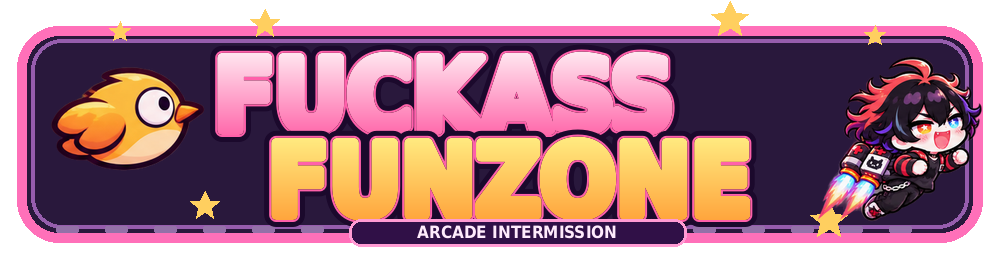
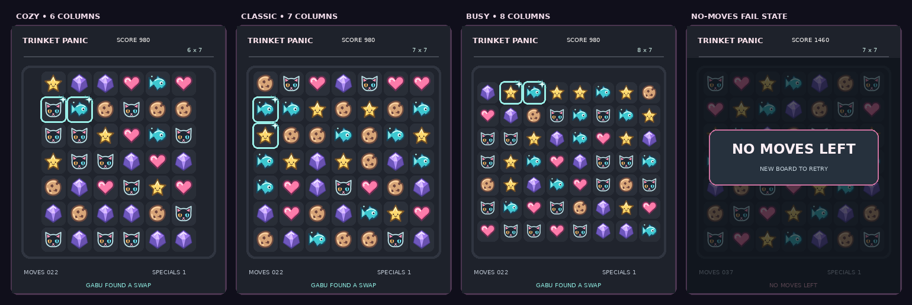
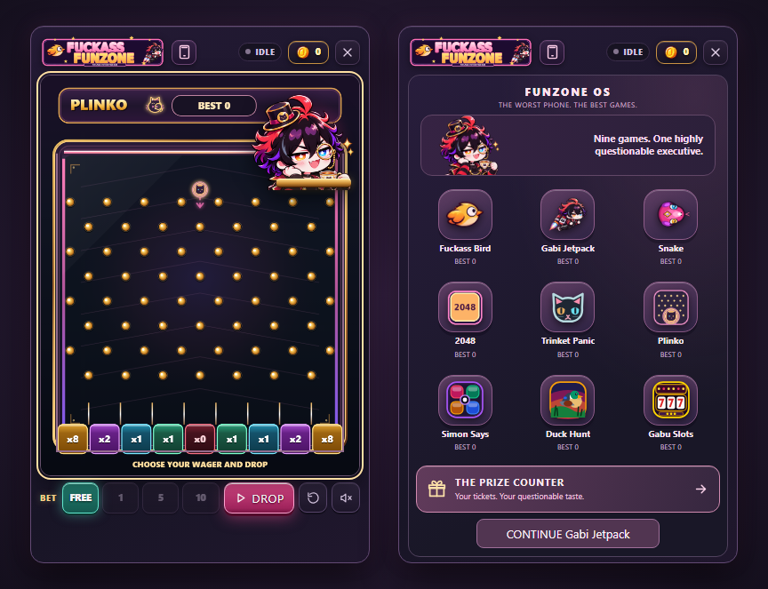

<p align="center">
  
</p>

<h1 align="center">Arcade Intermission</h1>

<p align="center">
  A pocket arcade for Lumiverse. Play a round while your next reply is on its way.
</p>

<p align="center">
  
  
  
</p>

## Pick a game

Open **Funzone OS** from the arcade drawer to launch any of the nine games in the floating cabinet.

| Game | How to play |
| --- | --- |
| **Fuckass Bird** | Tap, press Space, or press Up to flap through the gaps. |
| **Gabi Jetpack** | Hold to thrust, dodge buildings, and collect coins. |
| **Snake** | Swipe or use the arrow keys or WASD to steer toward snacks. |
| **2048** | Swipe or use the arrow keys or WASD to merge tiles. |
| **Trinket Panic** | Swap adjacent trinkets, make rockets and Gabu bombs, and choose a cozy, classic, or busy board. Timed rounds are optional. |
| **Plinko** | Drop a chip in free practice or play for fictional tickets. |
| **Simon Says** | Repeat the flashing sequence with the four pads or keys 1–4. |
| **Duck Hunt** | Tap or click flying ducks. Choose a timer or play an untimed hunt. |
| **Gabu Slots** | Spin in free practice or choose a fictional-ticket wager. |

### Visit the Prize Counter

Earn tickets as you play and trade them for cabinet themes, Snake skins, Plinko trails, and 2048 palettes. High scores, supported game saves, and cosmetics stay in your browser. Tickets have no cash value. The extension runs locally and reacts to generation events without reading prompts or replies.

## A peek inside

<table>
  <tr>
    <td width="50%"></td>
    <td width="50%"></td>
  </tr>
  <tr>
    <td align="center"><strong>Trinket Panic</strong></td>
    <td align="center"><strong>Plinko &amp; Funzone OS</strong></td>
  </tr>
</table>

## Install or update

1. If you're updating, back up your existing `data/extensions/fuckass_funzone` folder.
2. Place the project files so the manifest is at `data/extensions/fuckass_funzone/repo/spindle.json`. The bundled `dist/frontend.js` goes beside it under `repo/dist/`.
3. Enable the extension in Spindle. For an update, unload and re-enable it. Reload Lumiverse if it still shows the previous version.
4. Open **Funzone OS** from the arcade drawer and pick a game.

## Build and test

From the project root, run these commands with Node.js installed. The build embeds the bundled artwork and styles into `dist/frontend.js`.

```bash
npm run build
npm test
```

See the [testing guide](docs/TESTING.md) and the [v2.6.3 changelog](docs/CHANGELOG-2.6.3.md) for Gabi's updated flight expressions.
